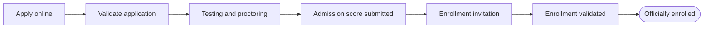
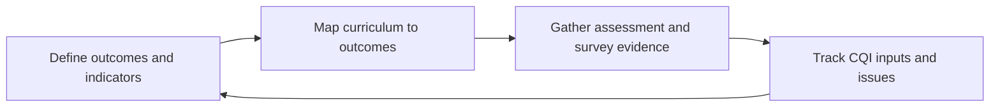
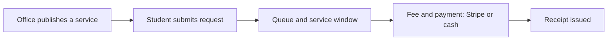
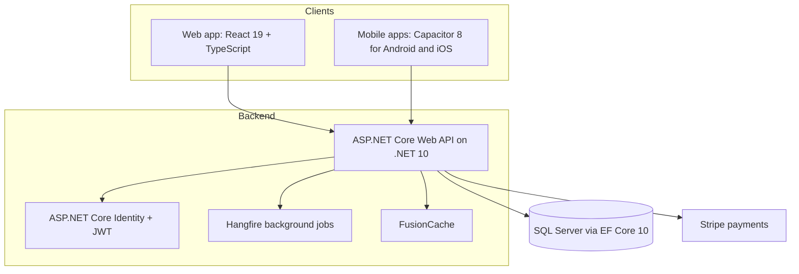

# 🎓 EduSync

### One platform for higher-education administration, admissions, student services and continuous quality improvement.

[**Overview**](#overview) · [**Features**](#product-features) · [**Roles**](#built-for-every-role) · [**Workflows**](#key-workflows) · [**Technology**](#technology) · [**Documentation**](#documentation)

> **Proprietary software.** EduSync is not open source. This page is a product overview; source code and implementation materials are not provided for public use. All rights are reserved by the applicable rights holder. No license to copy, modify, distribute, or create derivative works is granted.

---

## Overview

EduSync connects the offices of a higher-education institution on a single platform. Applicants, faculty, registrars, deans and administrators work from the same up-to-date records, so no one has to re-enter data between departments.

| Area | What it gives your institution |
| --- | --- |
| **Administration** | A structured model of campuses, colleges, programs, courses and terms |
| **Admissions & enrollment** | A connected path from public application to officially enrolled student |
| **Teaching & assessment** | Gradebooks, assessment tools, surveys and role-specific academic views |
| **Quality improvement** | Outcome mapping, KPIs and a CQI tracker that closes the loop |
| **Student services** | Service requests, office queues, fees, receipts and online payments |
| **Operations** | Access control, dashboards, AI configuration and job monitoring |

> Feature availability depends on an institution's configuration and the signed-in user's permissions.

---

## Product features

### 🏛️ Academic and institutional administration

- Manage agencies and campuses, colleges, departments, academic programs, buildings, rooms, and offices.
- Configure academic terms, subterms, cycles, fees, requirements, and account settings.
- Maintain courses, course catalogs, prerequisites, modules, sections, and schedules.
- Organize curriculum, program outcomes, capability indicators, and skills frameworks, with curriculum and outcome mapping views.
- Configure EQA types and labels, agency goals, vision and mission information, and key performance indicators.

### 📝 Admissions and enrollment

- Support university and program admissions, applicant eligibility, invitations, and application requirements.
- Provide public admission application pages for applicants to submit applications, supporting documents, and schedule selections.
- Coordinate admission schedules and enrollment invitations.
- Support admission application validation, testing-center management, proctor attendance, and admission-score submission.
- Validate enrollment and manage enrollment applications through to officially enrolled status.

### 📊 Teaching, assessment, and quality improvement

- Provide role-specific academic views for faculty, department chairs, college deans, program chairs, and registrars.
- Manage gradebook templates, grading periods, student grades, and course schedules.
- Build assessment tools, instruments, rating scales, and survey invitations.
- Collect survey responses and assessment results.
- Offer an AI chatbot for conversational assistance.
- Track CQI inputs, feedback, and issue reports to support continuous improvement.

### 💳 Student services and payments

- Publish office services and accept student service requests.
- Track request status and service processing through office queues and service windows, with a public queue display.
- Manage service applications, fees, payment status, and receipts.
- Support online payments through Stripe and record cash payments.

### ⚙️ Administration and operations

- Manage users, accounts, designations, and role-based access controls.
- Provide role-aware dashboards and campus information views, including an interactive, dynamic 3D campus map.
- Configure AI providers and monitor background jobs and server information.

---

## Built for every role

Each person sees a view shaped around their job. Role-based access keeps dashboards focused and data protected.

| Role | Typical tasks in EduSync |
| --- | --- |
| **Applicant** | Submit an application and documents, choose a testing schedule, respond to invitations, pay fees online |
| **Registrar** | Validate enrollment applications, move students to officially enrolled, maintain sections and schedules |
| **Faculty** | View course schedules, use gradebook templates, record grades, send assessments and surveys |
| **Department / Program chair** | Review curriculum and outcome mapping, follow assessment results and CQI items |
| **College dean** | Monitor program performance against goals and KPIs |
| **Office staff** | Process service requests, manage queues and windows, issue receipts, record cash payments |
| **Testing-center staff & proctors** | Manage testing sessions, record attendance, submit admission scores |
| **Administrator** | Manage users, designations and access, configure AI providers, monitor jobs and server information |

---

## Key workflows

### From applicant to enrolled student

### The continuous quality improvement loop

### Student service request

---

## Why institutions choose EduSync

- **One source of truth.** Admissions, academics, services and quality data live together instead of in separate tools.
- **Quality built in.** Outcome mapping, KPIs and CQI tracking are part of the platform, not an add-on.
- **Flexible structure.** Model multiple campuses, colleges, departments and programs with their own terms and requirements.
- **Accessible everywhere.** Use it in the browser, or through Android and iOS apps.
- **Controlled access.** Role-based permissions decide who sees and changes what.
- **Modern experience.** Responsive interface, interactive 3D campus map, public queue display and an AI chatbot.

---

## Technology

The application uses the following technologies. Badges link to their official project or documentation pages.

  
  
  
  
  
  
  
  
  
  
  
  
  
  
  
  

### Architecture at a glance

### Stack summary

| Layer | Technologies |
| --- | --- |
| **Backend** | ASP.NET Core Web API on .NET 10, Entity Framework Core 10, SQL Server, Scalar for API documentation |
| **Frontend** | React 19, TypeScript, Vite 8, Tailwind CSS 4, shadcn/ui components, Leaflet maps |
| **Frontend utilities** | Zod for schema validation. Zustand is present in the dependency lockfile as a transitive dependency, but is not declared as a direct application dependency. |
| **Mobile** | Capacitor 8 for Android and iOS app packaging |
| **API integration** | OpenAPI-based client generation with Orval |
| **Code generation** | [Storm CLI](https://github.com/HolliShake/storm-cli), an API starter kit used to generate code |
| **Build protection** | JavaScript obfuscation is configured for frontend production builds |
| **Additional services** | ASP.NET Core Identity and JWT authentication, Hangfire background jobs, and Stripe payments |
| **Frontend libraries** | [React Router](https://reactrouter.com/), [TanStack Query](https://tanstack.com/query), [React Hook Form](https://react-hook-form.com/), [Axios](https://axios-http.com/), [FullCalendar](https://fullcalendar.io/), [Recharts](https://recharts.org/), [Three.js](https://threejs.org/) with [React Three Fiber](https://r3f.docs.pmnd.rs/) and [Drei](https://github.com/pmndrs/drei), [Tiptap](https://tiptap.dev/), [Radix UI](https://www.radix-ui.com/), [Base UI](https://base-ui.com/), [React Leaflet](https://react-leaflet.js.org/), and [Stripe.js](https://stripe.com/docs/js) |
| **Backend libraries** | [AutoMapper](https://automapper.org/), [FusionCache](https://github.com/ZiggyCreatures/FusionCache), [ClosedXML](https://closedxml.io/), [BCrypt.Net](https://github.com/BcryptNet/bcrypt.net), [Scrutor](https://github.com/khellang/Scrutor), and [Swashbuckle](https://github.com/domaindrivendev/Swashbuckle.AspNetCore) for OpenAPI support |
| **Developer tooling** | [ESLint](https://eslint.org/), [Prettier](https://prettier.io/), and the [React Compiler](https://react.dev/learn/react-compiler) |

---

## Documentation

Product and administration documentation is available in the **[EduSync Administrator guide](https://hollishake.github.io/edusync-base/)**.

---

## Frequently asked questions

**Is EduSync open source?**
No. EduSync is proprietary software, and no license to copy, modify, distribute, or create derivative works is granted.

**Can applicants apply without an account?**
EduSync provides public admission application pages where applicants submit applications, supporting documents, and schedule selections.

**How are payments handled?**
Online payments run through Stripe, and cash payments can be recorded manually. Payment status and receipts are tracked per service application.

**Does it work on mobile?**
Yes. The interface is responsive, and Capacitor 8 is used to package Android and iOS apps.

**Will every institution see the same features?**
No. Availability depends on the institution's configuration and each signed-in user's permissions.

---

## Proprietary notice

EduSync and its associated software, product design, and materials are proprietary. No part may be copied, redistributed, reverse engineered, or used to create derivative works without prior written permission from the rights holder, except where applicable law expressly permits it.
