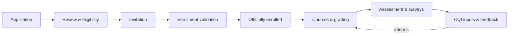
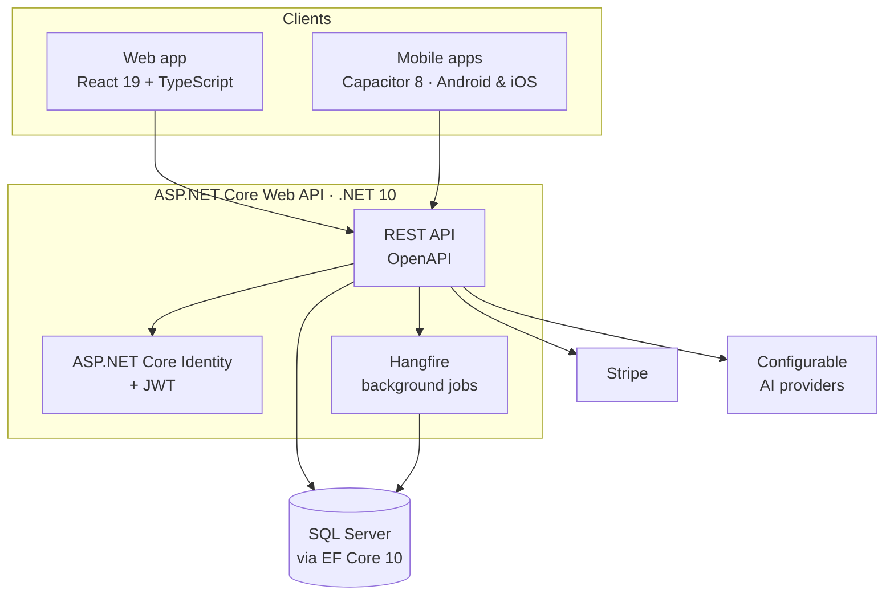

# 🎓 EduSync

### One platform for academic administration, admissions, student services, and continuous quality improvement.

*Built for higher-education institutions that want to run campus operations and improve outcomes from the same place.*

 

 

[**Overview**](#-overview) · [**Features**](#-product-features) · [**Roles**](#-built-around-roles) · [**Architecture**](#-architecture) · [**Technology**](#-technology) · [**Documentation**](#-documentation) · [**License**](#-proprietary-notice)

---

> [!IMPORTANT]
> **Proprietary software.** EduSync is not open source. This page is a product overview; source code and implementation materials are not provided for public use. All rights are reserved by the applicable rights holder. No license to copy, modify, distribute, or create derivative works is granted.

## ✨ Overview

Institutions often run admissions, registrar work, grading, student services, and quality assurance in separate tools. EduSync brings them together in a single platform, so data flows from an applicant's first submission through enrollment, instruction, assessment, and the improvement actions that follow.

| | |
|---|---|
| 🏛️ **Administer** | Campuses, colleges, departments, programs, terms, courses, and facilities |
| 📝 **Admit & Enroll** | Applications, eligibility, invitations, and enrollment through to officially enrolled |
| 📊 **Teach & Assess** | Gradebooks, assessment tools, surveys, and results by role |
| 🔁 **Improve** | CQI inputs, feedback, issue reports, EQA labels, goals, and KPIs |
| 💳 **Serve & Collect** | Office services, request queues, and Stripe or cash payments |
| 🛡️ **Operate** | Role-based access, dashboards, a 3D campus map, AI providers, and job monitoring |

---

## 🧩 Product features

> Feature availability depends on an institution's configuration and the signed-in user's permissions.

### 🏛️ Academic and institutional administration

| Area | What you can do |
|---|---|
| **Structure** | Manage agencies and campuses, colleges, departments, academic programs, buildings, rooms, and offices |
| **Calendar & fees** | Configure academic terms, subterms, cycles, fees, requirements, and account settings |
| **Curriculum** | Maintain courses, course catalogs, prerequisites, modules, sections, and schedules |
| **Outcomes** | Organize curriculum, program outcomes, capabilities, capability indicators, and skills frameworks |
| **Quality frameworks** | Configure EQA types and labels, agency goals, vision and mission information, and key performance indicators |

### 📝 Admissions and enrollment

- **Admissions:** support university and program admissions, applicant eligibility, invitations, and application requirements.
- **Review:** collect and review application submissions, supporting documents, and application history.
- **Scheduling:** coordinate admission schedules and enrollment invitations.
- **Enrollment:** validate enrollment and manage enrollment applications through to officially enrolled status.

### 📊 Teaching, assessment, and quality improvement

- **Role-specific academic views** for faculty, department chairs, college deans, program chairs, and registrars.
- **Grading:** manage gradebook templates, grading periods, student grades, and course schedules.
- **Assessment:** build assessment tools, instruments, rating scales, and survey invitations, then collect survey responses and results.
- **AI assistance:** an AI chatbot for conversational help.
- **Continuous improvement:** track CQI inputs, feedback, and issue reports to support ongoing improvement.

### 💳 Student services and payments

- **Services:** publish office services and accept student service requests.
- **Tracking:** follow request status and processing through office queues and service windows.
- **Billing:** manage service applications, fees, and payment status.
- **Payments:** online payments through **Stripe**, plus recorded **cash** payments.

### 🛡️ Administration and operations

- **Access control:** manage users, accounts, designations, and role-based permissions.
- **Dashboards:** role-aware dashboards and campus information views, including an **interactive, dynamic 3D campus map**.
- **Operations:** configure AI providers and monitor background jobs and server information.

---

## 👥 Built around roles

EduSync presents each person with the views and tools their job needs.

| Role | Focus |
|---|---|
| **Faculty** | Course schedules, gradebooks, assessments |
| **Department chairs** | Departmental academic oversight and review |
| **College deans** | College-level academic views |
| **Program chairs** | Program curriculum, outcomes, and quality |
| **Registrars** | Enrollment validation and academic records |
| **Office staff** | Service queues, windows, and payment handling |
| **Administrators** | Users, designations, access control, system configuration |
| **Students & applicants** | Applications, enrollment, service requests, payments, surveys |

---

## 🔄 From applicant to improvement

---

## 🏗️ Architecture

---

## 🛠️ Technology

Badges link to their official project or documentation pages.

  
  
  
  
  
  
  
  
  
  
  
  
  
  

| Layer | Stack |
|---|---|
| **Backend** | ASP.NET Core Web API on .NET 10, Entity Framework Core 10, SQL Server |
| **Frontend** | React 19, TypeScript, Vite 8, Tailwind CSS 4, shadcn/ui components, Leaflet maps |
| **Frontend utilities** | Zod for schema validation. Zustand appears in the dependency lockfile as a transitive dependency and is not declared as a direct application dependency. |
| **Mobile** | Capacitor 8 for Android and iOS app packaging |
| **API integration** | OpenAPI-based client generation with Orval |
| **Build protection** | JavaScript obfuscation configured for frontend production builds |
| **Services** | ASP.NET Core Identity and JWT authentication, Hangfire background jobs, Stripe payments |

---

## 📚 Documentation

**Looking for setup, configuration, or day-to-day guidance?**

The [EduSync Administrator guide](https://hollishake.github.io/edusync-base/) covers product and administration documentation.

---

## ⚖️ Proprietary notice

EduSync and its associated software, product design, and materials are proprietary. No part may be copied, redistributed, reverse engineered, or used to create derivative works without prior written permission from the rights holder, except where applicable law expressly permits it.

© All rights reserved by the applicable rights holder.

